# Family tree

The family's Bentley line as the records currently support it. The Ancestry tree carries this line back
to John G. Bentley of High Bentley Hall (died 1540), but in the 1600s it joins together families
that aren't connected (see [the two breaks](research/2026-10-10-the-two-breaks.md)). The
documented line is a **Saddleworth** family. It goes back to Matthew Bentley of Standedge (died
1751), and very probably to Jonas Bentley in the 1650s and a Mathew Bentley in 1613.

Living people are not included. The public line stops at Roy Bentley (died 1998).

Sources and citations:
- [The two breaks](research/2026-10-10-the-two-breaks.md): the 1500s–1600s and the Saddleworth line back to 1613
- [Tree check](research/2026-10-10-tree-check.md): each generation of the Ancestry tree checked
- [Source checks](research/2026-10-10-source-checks.md): High Bentley, Shelf and the 1540 records
- [Ancestry tree transcription](research/2026-10-10-ancestry-tree.md): the tree as exported

_Last updated: 10 October 2026_

## The documented line

```mermaid
flowchart TD
    classDef found fill:#e6f4ea,stroke:#2e7d32,color:#1b1b1b
    classDef probable fill:#fff8e1,stroke:#b8860b,color:#1b1b1b
    classDef unchecked fill:#f3f3f3,stroke:#777777,color:#1b1b1b

    S1["Mathew Bentley<br/>children bap. Saddleworth 1613, 1614"]:::probable
    S2["Jonas Bentley<br/>sons bap. 1654, 1664<br/>bur. 1686?"]:::probable
    S3["Mathew Bentley<br/>bap. 11 Dec 1664<br/>'old Matthew' of Standedge, bur. 1735/6"]:::probable
    G11["Matthew Bentley of Standedge<br/>clothier, bur. 20 Nov 1751<br/>m. Sarah"]:::found
    G12["James Bentley<br/>bap. 25 Mar 1722<br/>m. Mary Nield 1745"]:::found
    G13["John Bentley<br/>bap. 11 Oct 1750<br/>m. Ann Broadbent 1771"]:::found
    G14["William S. Bentley<br/>1788–1835<br/>m. Betty Bottomley"]:::unchecked
    G15["Charles Bentley<br/>c.1827–1897<br/>m. Sarah Dyson 1855"]:::found
    G16["John D. Bentley<br/>1861–1918"]:::found
    G17["Thomas Herbert Bentley<br/>1888–1965<br/>m. Lauretta Jones 1920"]:::found
    G18["Roy Bentley<br/>1930–1998"]:::found
    PRIV["Later generations<br/>(private)"]:::unchecked

    S1 -.->|not yet proven| S2
    S2 -->|baptism| S3
    S3 -.->|"probable: same farm"| G11
    G11 -->|baptism| G12
    G12 -->|baptism| G13
    G13 -.->|not yet checked| G14
    G14 -.->|not yet checked| G15
    G15 -.->|"not yet checked<br/>(census)"| G16
    G16 -.->|"not yet checked<br/>(census)"| G17
    G17 -->|"birth index:<br/>mother née Jones"| G18
    G18 --- PRIV

    linkStyle 1,3,4,9 stroke:#2e7d32,stroke-width:2px
```

Boxes: green means the person is found in records matching the tree; yellow means found in
records, with a link still to prove; grey means not yet checked. Arrows: solid green means a
record names the parent; dashed means no record yet either way.

## Evidence status

| Status | Meaning |
| --- | --- |
| **Documented** | A contemporary record says it directly |
| **Probable** | Records point strongly this way, but no single record says it |
| **Supported** | Records point this way but don't prove it on their own |
| **Recorded only** | In a family tree or pedigree; no record found yet |
| **Conflicting** | Records disagree with the claim |

## Generations, oldest first

Dates in **bold** are corrections from the records.

| Person | In the records | Link to parent |
| --- | --- | --- |
| Mathew Bentley of Saddleworth, fl. 1613–1614 | Children An (1613) and Mathew (1614) baptised; possibly the "Mathey" Bentley buried 1657/8 | — |
| Jonas Bentley of Saddleworth, fl. 1654–1664 | Sons John (1654) and Mathew (1664) baptised; probably the "Jonah" Bentley buried 1686 | Not yet proven |
| Mathew ("old Matthew") Bentley of Standedge, 1664–1736 | Baptised 11 Dec 1664, son of Jonas. Children 1700–1703; wife Ellin buried 1719. Buried 26 Feb 1735/6 as "old Matthew" of Stone-edge. | Documented, if this is the same Mathew |
| Matthew Bentley of Standedge, c.1692–1751; m. Sarah | Clothier, buried 20 Nov 1751; nine children baptised 1722–1744 | Probable (son of old Matthew) |
| James Bentley, b. **1722**; m. Mary Nield | Baptised 25 Mar 1722, son of Matthew and Sarah; married 26 Dec 1745 | Documented |
| John Bentley, 1750–1789; m. Ann Broadbent | Baptised 11 Oct 1750, son of James and Mary; married 2 Apr 1771 | Documented |
| William S. Bentley, 1788–1835; m. Betty Bottomley | Not yet checked | Not yet checked |
| Charles Bentley, b. **c.1826–27**, d. 1897; m. Sarah Dyson | Married 1855; died 1897 aged 70 | Not yet checked |
| John D. Bentley, b. **1861**, d. 1918; m. Sarah Ann | Birth and death in the GRO index | Not yet checked |
| Thomas Herbert Bentley, 1888–1965; m. Lauretta **Jones** | Born Jan–Mar 1889 quarter; married 1920 | Not yet checked |
| Roy Bentley, 1930–1998 | Born 1930, mother's maiden name Jones | Supported |

## What happened to the Ancestry tree's earlier generations

The Ancestry tree reaches Matthew Bentley through people who belong to other families:

| In the Ancestry tree | Who they really are | Status |
| --- | --- | --- |
| John Bentley (b. 1665, Saddleworth; d. Baildon) m. Grace Horsfeild | A Bingley/Baildon John Bentley, married at Bingley 1684. No baptism in 1665. | **Conflicting** as Matthew's father |
| John G. Bentley (b. 1640, Bingley) | No record | Recorded only |
| Jeremiah Bentley (1624–1665) m. Dority Dyson | Jeremy Bentley of Elland Hall, MP, son of **George** Bentley; children 1647–1665, no John | **Conflicting** as John G.'s father and as John & Phoebe's son |
| John Bentley (c.1603–1651) m. Phoebe Longbotham | Probably the same man as John of Staups House, split in two. Phoebe Longbotham (bap. 1609) was someone else. | **Conflicting** |
| Jon Bentley "the Elder" (1579–1648) m. Agnes Blackburne | John Bentley of Staups House, Shibden: bap. 18 Jan 1578/9; m. Agnes Blackburne 1599 and Phebe 1612; his **daughters** inherited | Documented as Richard's son |
| Richard Bentley (b. 17 Aug 1554, d. 1636) m. Isabel Brodley | Richard Bentley of Staups House: son of **Richard of Northowram**; m. Isabel 22 Oct 1576; **died before Aug 1600** | Documented (baptism); conflicting with the tree's father and death date |
| Isabel Brodley (b. 1555, d. 1589) | Probably daughter of Richard Brodley of Hipperholme, bap. 26 Sep 1555; **remarried Edward Sawley 18 Aug 1600** | Supported |
| Edwardus Bentley of Ovenden (d. 1592) | Buried 23 Apr 1592; his own son Richard (bap. 1559) stayed in Ovenden | **Conflicting** as the father of the tree's Richard |
| John G. Bentley of High Bentley (d. 1540); Sir John of Monmouth; James (b. 1419) | See below | Recorded only |

## The High Bentley and Shelf Bentleys (not yet connected to this line)

### John G. Bentley of High Bentley Hall (recorded 1504 – 1 August 1540)

| Claim | Status | Evidence |
| --- | --- | --- |
| Died 1 August 1540, Halifax | **Documented**, for *a* John Bentley of Shelf | Halifax parish register: "Joh̃es Bentley de Schelff" buried 1 August 1540. Not yet proven to be the man in the Ancestry tree. |
| Of High Bentley Hall | **Supported** | A will of 30 June 1540 mentions land "at the Hie Bentley" leased from "Agnes, the late wif of John Bentley". |
| Same man as both of the above | **Conflicting** | "Late wife" usually means widow, which would put John's death before 30 June 1540, a month *before* the 1 August burial. There may be two John Bentleys. |
| Born 1504 at High Bentley | **Recorded only** | Halifax registers start in 1538, so no baptism record can exist. The year is an estimate. |
| Middle initial "G." | **Doubtful** | Middle names were almost unknown in England at this date. |
| Son of Sir John Bentley | **Recorded only** | No record found. |
| Father of Edward Bentley of Ovenden | **Recorded only** | No record found. |

### His wife: "Agnes Waterhouse" / "Lady A M Waterhouse"

| Claim | Status | Evidence |
| --- | --- | --- |
| Wife of John Bentley | **Supported** | "Agnes, the late wif of John Bentley" held land at High Bentley by 30 June 1540 (Brooke will). |
| Maiden name Waterhouse | **Recorded only** | No record found yet. |
| Died 8 August 1566 at Chelmsford, Essex (Ancestry) | **Doubtful** | No known link to Essex. "Agnes Bentley vidua" (widow) married Edward Berstowe (Bairstow) at Halifax on 20 November 1542; she may be the same Agnes. |

### Sir John Bentley, Isabel Brookhouse and James Bentley

| Claim | Status | Evidence |
| --- | --- | --- |
| Sir John Bentley of Monmouth existed as described | **Recorded only** | Not yet searched. |
| Isabel Brookhouse was John G.'s mother | **Conflicting** | Her recorded death (1503) is before John G.'s recorded birth (1504). |
| James Bentley (b. 1419) was Sir John's father | **Recorded only** | Not yet searched. |

### Bentleys and Bairstows at Shelf and High Bentley

| Person | Date | Record |
| --- | --- | --- |
| Bentley family of Shelf | 1296 | Recorded in Shelf (Calderdale Companion; underlying record not yet identified) |
| Thomas de Bentley | 1379 | One of 10 people in Shelf who paid poll tax |
| William Bentley | died by 1496 | Father of Laurence |
| Laurence Bentley | 1496 | Paid a fine for waste land in Shelf after his father's death |
| Arthur Bentley | 1537 | "Of High Bentley Hall, Shelf"; trustee of William Thorpe's charity |
| Agnes, late wife of John Bentley | by 30 June 1540 | Leased out land at High Bentley |
| John Bentley of Shelf | buried 1 August 1540 | Halifax parish register |
| Agnes Bentley, widow | 20 November 1542 | Married Edward Berstowe (Bairstow) |
| Edward Bentley of Shelf | died by June 1543 | Daughter Margaret buried 1541; widow Margaret buried 1543 |
| John Berstowe "de Hie Bentlei" | buried 17 January 1562/3 | Halifax parish register |
| Thomas Bairstowe of High Bentley | will dated 12 January 1576 | York will index |

By the 1560s High Bentley was in the hands of the Bairstows, possibly through Agnes's second
marriage. See [the two breaks](research/2026-10-10-the-two-breaks.md#a-lead-on-high-bentley-hall).
