# Family tree

The Bentley line rebuilt from records. It starts with Roy Bentley (1930–1998), whom the family
knows to be the son of Thomas Bentley. Each earlier generation is added only where a record
supports it.

Roy's descendants are not included in this public repository.

Full evidence and citations: [the line rebuilt from records](research/2026-10-10-line-from-records.md)
(Roy back to William) and [the Saddleworth line](research/2026-10-10-saddleworth-line.md) (William
back to 1613), with more in [the two breaks](research/2026-10-10-the-two-breaks.md) and the
[tree check](research/2026-10-10-tree-check.md).

_Last updated: 10 October 2026_

## The line

```mermaid
flowchart TD
    classDef found fill:#e6f4ea,stroke:#2e7d32,color:#1b1b1b
    classDef probable fill:#fff8e1,stroke:#b8860b,color:#1b1b1b
    classDef gap fill:#f3f3f3,stroke:#777777,color:#1b1b1b

    A1["Mathew Bentley<br/>Saddleworth, children bap. 1613–14"]:::probable
    A2["Jonas Bentley<br/>sons bap. 1654, 1664<br/>d. 1686, Saddleworth"]:::probable
    A3["Mathew ('old Matthew') Bentley<br/>bap. 1664, bur. 1735/6, Standedge"]:::probable
    A4["Matthew Bentley of Standedge<br/>clothier, d. 1751; m. Sarah"]:::found
    A5["James Bentley<br/>bap. 1722, d. 1790?<br/>m. Mary Nield 1745"]:::found
    A6["John Bentley of Standedge<br/>bap. 1750, d. 1789<br/>m. Ann Broadbent 1771"]:::found
    B1["William Bentley<br/>bap. 1788 Saddleworth, d. 1835?<br/>m. Betty Bottomley 1815"]:::probable
    B2["Charles Bentley<br/>b. c.1827 Saddleworth, d. 1897<br/>m. Sarah Dyson 1855"]:::found
    B3["John Bentley<br/>b. 1861 Marsden, d. 1918<br/>m. Sarah Ann Haigh 1883"]:::found
    B4["Thomas Herbert Bentley<br/>b. 1888/9 Marsden, d. 1965<br/>m. Lauretta Jones 1920"]:::found
    B5["Roy Bentley<br/>1930–1998<br/>m. Margaret Cartwright 1953"]:::found
    P["Later generations<br/>(private)"]:::gap

    A1 -.->|not yet proven| A2
    A2 -->|baptism| A3
    A3 -.->|"probable:<br/>same farm"| A4
    A4 -->|baptism| A5
    A5 -->|baptism| A6
    A6 -->|"baptism 1788<br/>(names John and Ann)"| B1
    B1 -.->|"probable: Betty's husband<br/>(1815 marriage, 1851 census)"| B2
    B2 -->|"1861, 1871<br/>censuses"| B3
    B3 -->|"1891 census"| B4
    B4 -->|"birth index:<br/>mother née Jones"| B5
    B5 --- P

    linkStyle 1,3,4,5,7,8,9 stroke:#2e7d32,stroke-width:2px
```

Boxes: green means the person is found in records; yellow means found in records, but part of
how they join the line is still inference (see the table below). Arrows: solid green means a
record names the parent; dashed means probable, not yet proven.

The records carry the line back **without a gap to William and Betty Bentley, married at
Saddleworth in 1815**, and William's own baptism has now been found: **8 April 1788, William,
son of John and Ann Bently, clothier.** John and Ann were the only John and Ann Bentley having
children at Saddleworth at the time, so William's parents are documented. What is still
inference is that this William is the one who married Betty and fathered Charles. It is very
probable: he is the only William Bentley of the right age, and the family's own dates fit him.
**This tree works on that assumption.** See
[the Saddleworth line](research/2026-10-10-saddleworth-line.md#1-william-bentley-baptised-1788).

The family lived at **Standedge** for at least four generations, from the 1720s to the 1800s,
on a farm known as **"Bentleys"**. Deeds at Oldham Archives show two Bentley clothiers buying it
from the lord of the manor in 1791 and selling it in 1806. See
[the Saddleworth line](research/2026-10-10-saddleworth-line.md#7-bentleys-the-family-home-at-standedge).

## Evidence status

| Status | Meaning |
| --- | --- |
| **Documented** | A contemporary record says it directly |
| **Probable** | Records point strongly this way, but no single record says it |
| **Supported** | Records point this way but don't prove it on their own |
| **Not yet proven** | No record found yet either way |

## Generations, newest first

| Gen. | Person | Born – died | Married | Parent link | Status |
| --- | --- | --- | --- | --- | --- |
| 1 | **Roy Bentley** | 1930 Huddersfield – 1998 | **Margaret Cartwright** (1934–1991), 1953, Upper Agbrigg | Son of Thomas H. (birth index: mother née Jones) | Documented |
| 2 | **Thomas Herbert Bentley** | 1888/9 Marsden – 1965 Huddersfield | **Lauretta Jones** (1887/8–1963), 1920 | Son of John and Sarah A. (1891 census) | Documented |
| 3 | **John Bentley** | early **1861** Marsden – 1918 | **Sarah Ann Haigh** (c.1857–1934), 1883 | Son of Charles and Sarah (1861, 1871 censuses) | Documented |
| 4 | **Charles Bentley** | c.1827 Saddleworth – 1897 | **Sarah Dyson** (c.1831–1874), 1855 | Son of Betty, widow (1851 census) | Documented (mother); probable (father) |
| 5 | **William Bentley** | bap. 8 Apr 1788 Saddleworth – before 1851 (tree: d. 1835) | **Betty Bottomley** (c.1782–?), 5 Jan 1815, Saddleworth | Son of John and Ann (baptism) | Documented (parents); probable that he is Betty's husband |
| 6 | John Bentley of Standedge, clothier | bap. 1750 Saddleworth – bur. 15 Nov 1789, Standedge | Ann Broadbent, 1771 | Son of James and Mary (baptism) | Documented |
| 7 | James Bentley, clothier | bap. 1722 Saddleworth – probably bur. 8 Feb 1790, Standedge | Mary Nield, 1745 | Son of Matthew and Sarah (baptism) | Documented |
| 8 | Matthew Bentley of Standedge, clothier | c.1692 – bur. 20 Nov 1751; will proved 1753 | Sarah | Probably son of "old Matthew" (same farm) | Probable |
| 9 | Mathew ("old Matthew") Bentley | bap. 1664 – bur. 26 Feb 1735/6, Stone-edge | Ellin (d. 1719) | Son of Jonas (baptism) | Documented, if the same Mathew |
| 10 | Jonas Bentley | fl. 1654–1664 – bur. 6 Jul 1686; administration 1686 | — | Not yet proven | — |
| 11 | Mathew Bentley | fl. 1613–1614 | — | — | Earliest Bentley in the Saddleworth registers |

## Brothers and sisters found in the records

- **Generation 1:** Dorothy Bentley (1920–1989), who married Norman A. Jagger (1911–1976).
- **Generation 2** (1891 census): Willie (c.1885), Sarah H. (c.1887) and Sam (c.1890). The family
  also records Mary Ellen (c.1894) and John E. (c.1895).
- **Generation 3** (1861, 1871 censuses): Elizabeth (c.1856), Rebecca (c.1859), Joseph W.
  (c.1864), James (c.1868) and Charles E. (c.1870).
- **Generation 4** (1851 census): John (c.1815), William (c.1827), Wright (c.1830) and Ann
  (c.1833). The family also records a Joseph (1821), and that Joseph, William and Wright died at
  St Kilda, Victoria, Australia.
- **Generation 5** (baptisms, Saddleworth): John (1776, died in infancy), John (1777, died in
  infancy), James (died 1778), William (1779, died in infancy), John (1781) and James (1784).
- **Generation 6:** Sarah (1748), Esther (1753), Mary (1756) and James (1761).
- **Generation 7:** Mary (1723/4), Sarah (1726), John (1728/9, died 1736), Esther (1731), Helen
  (1733/4), Anna (1736, died 1755), Matthew (1738/9), Alice (1741) and Betty (1743/4).

## Other family lines to explore

Each marriage brings in another family. None has been researched yet:

- **Cartwright:** Margaret Cartwright, born 2 June 1934, Huddersfield; probably the Margaret
  Cartwright whose birth index entry gives her mother's maiden name as Mayall.
- **Jones:** Lauretta Jones, born 1887/8, Barkisland (Halifax district).
- **Haigh:** Sarah Ann Haigh, born about 1857, Marsden; her uncle Dan Haigh (born about 1820,
  Marsden).
- **Dyson:** Sarah Dyson, born about 1831, Marsden.
- **Bottomley:** Betty Bottomley, born about 1782, Saddleworth.

## Earlier research: the Ancestry tree and High Bentley Hall

This project began by testing an Ancestry family tree that traced the family back to John G.
Bentley of High Bentley Hall, Shelf, near Halifax (died 1540), and beyond to Monmouth. Checked
against the records, that tree turned out to join several unrelated families together, so it has
been set aside. Its correct parts (Charles Bentley onwards) match the line above.

The research is kept for reference:

- [The Ancestry tree as exported](research/2026-10-10-ancestry-tree.md)
- [The tree checked against the records](research/2026-10-10-tree-check.md)
- [The two breaks in the tree](research/2026-10-10-the-two-breaks.md): the Halifax and Elland
  Bentleys, and how the Saddleworth line was found
- [High Bentley Hall, Shelf and the 1540 records](research/2026-10-10-source-checks.md)

No record so far connects this family to High Bentley Hall.
