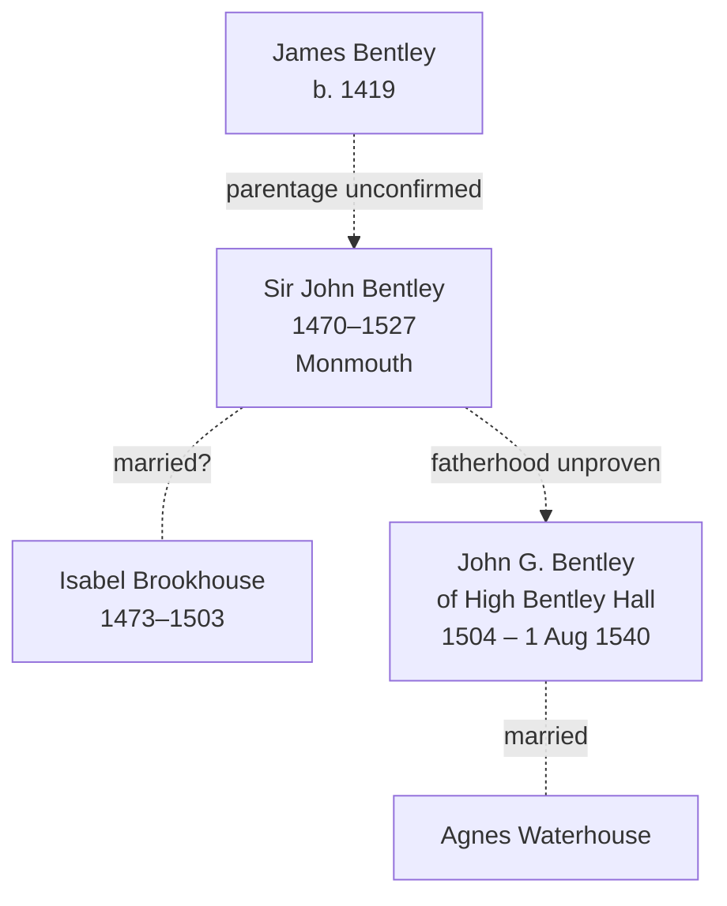

# Family tree

The tree as recorded on Ancestry and in your own notes, with the evidence found so far for each
person. Every link is drawn dashed because no parent–child link has yet been proven from records.
Evidence details and citations are in [research/2026-10-10-source-checks.md](research/2026-10-10-source-checks.md).

_Last updated: 10 October 2026_

## Evidence status

| Status | Meaning |
| --- | --- |
| **Documented** | A contemporary record says it directly |
| **Supported** | Records point this way but don't prove it on their own |
| **Recorded only** | In a family tree or pedigree; no record found yet |
| **Conflicting** | Records disagree with the claim |

### John G. Bentley of High Bentley Hall (recorded 1504 – 1 August 1540)

| Claim | Status | Evidence |
| --- | --- | --- |
| Died 1 August 1540, Halifax | **Documented**, for *a* John Bentley of Shelf | Halifax parish register: "Joh̃es Bentley de Schelff" buried 1 August 1540. Not yet proven to be the man in the Ancestry tree. |
| Of High Bentley Hall | **Supported** | A will of 30 June 1540 mentions land "at the Hie Bentley" leased from "Agnes, the late wif of John Bentley". |
| Same man as both of the above | **Conflicting** | "Late wife" usually means widow, which would put John's death before 30 June 1540, a month *before* the 1 August burial. There may be two John Bentleys. |
| Born 1504 at High Bentley | **Recorded only** | Halifax registers start in 1538, so no baptism record can exist. The year is an estimate. |
| Middle initial "G." | **Doubtful** | Middle names were almost unknown in England at this date. |
| Son of Sir John Bentley | **Recorded only** | No record found. |

### Agnes Waterhouse (wife of John G. Bentley)

| Claim | Status | Evidence |
| --- | --- | --- |
| Wife of John Bentley | **Supported** | "Agnes, the late wif of John Bentley" held land at High Bentley by 30 June 1540 (Brooke will). |
| Maiden name Waterhouse | **Recorded only** | No record found yet. |
| Remarried after John's death | **Lead** | "Agnes Bentley vidua" (widow) married Edward Berstowe at Halifax on 20 November 1542. She may or may not be the same Agnes. |

### Sir John Bentley (recorded 1470–1527, Monmouth)

| Claim | Status | Evidence |
| --- | --- | --- |
| Existed as described | **Recorded only** | Not yet searched. |
| Father of John G. Bentley | **Recorded only** | No record found. |

### Isabel Brookhouse (recorded 1473–1503)

| Claim | Status | Evidence |
| --- | --- | --- |
| Wife of Sir John Bentley | **Recorded only** | Not yet searched. |
| Mother of John G. Bentley | **Conflicting** | Her recorded death (1503) is before John G.'s recorded birth (1504). |

### James Bentley (recorded b. 1419)

| Claim | Status | Evidence |
| --- | --- | --- |
| Existed; ancestor of Sir John | **Recorded only** | Not yet searched. Parentage unconfirmed. |

## Bentleys of Shelf on record, not yet linked to the tree

| Person | Date | Record |
| --- | --- | --- |
| Bentley family of Shelf | 1296 | Recorded in Shelf (Calderdale Companion; underlying record not yet identified) |
| Thomas de Bentley | 1379 | One of 10 people in Shelf who paid poll tax |
| William Bentley | died by 1496 | Father of Laurence |
| Laurence Bentley | 1496 | Paid a fine for waste land in Shelf after his father's death |
| Arthur Bentley | 1537 | "Of High Bentley Hall, Shelf"; trustee of William Thorpe's charity |
| Agnes, late wife of John Bentley | by 30 June 1540 | Leased out land at High Bentley |
| John Bentley of Shelf | buried 1 August 1540 | Halifax parish register |
| Edward Bentley of Shelf | died by June 1543 | Daughter Margaret buried 1541; widow Margaret buried 1543 |
