# Family tree

The direct line as recorded on Ancestry, from John G. Bentley of High Bentley (died 1540) to the
20th century, with the evidence found so far for each generation. The full transcription of the
Ancestry tree is in [research/2026-10-10-ancestry-tree.md](research/2026-10-10-ancestry-tree.md).
Citations for every finding are in
[research/2026-10-10-tree-check.md](research/2026-10-10-tree-check.md) and
[research/2026-10-10-source-checks.md](research/2026-10-10-source-checks.md).

Living people are not included. The public line stops at Roy Bentley (died 1998).

_Last updated: 10 October 2026_

```mermaid
flowchart TD
    classDef found fill:#e6f4ea,stroke:#2e7d32,color:#1b1b1b
    classDef notfound fill:#fdecea,stroke:#c62828,color:#1b1b1b
    classDef unchecked fill:#f3f3f3,stroke:#777777,color:#1b1b1b

    G1["James Bentley<br/>b. 1419"]:::notfound
    G2["Sir John Bentley of Monmouth<br/>1470–1527"]:::notfound
    G3["John G. Bentley of High Bentley<br/>John Bentley of Shelf bur. 1 Aug 1540"]:::found
    G4["Edward Bentley of Ovenden<br/>bur. 23 Apr 1592"]:::found
    G5["Richard Bentley<br/>bap. 17 Aug 1554<br/>m. Isabel Brodley 1576"]:::found
    G6["John Bentley of Shibden<br/>bap. 18 Jan 1578/9"]:::found
    G7["John Bentley<br/>c.1603–1651<br/>m. Phoebe Longbotham"]:::unchecked
    G8["Jeremiah (Jeremy) Bentley<br/>of Elland Hall, MP<br/>d. 17 Jan 1664/5"]:::found
    G9["John G. Bentley<br/>b. 1640, Bingley"]:::notfound
    G10["John Bentley<br/>b. 1665, Saddleworth"]:::notfound
    G11["Matthew Bentley of Standedge<br/>clothier, bur. 20 Nov 1751"]:::found
    G12["James Bentley<br/>bap. 25 Mar 1722<br/>m. Mary Nield 1745"]:::found
    G13["John Bentley<br/>bap. 11 Oct 1750<br/>m. Ann Broadbent 1771"]:::found
    G14["William S. Bentley<br/>1788–1835<br/>m. Betty Bottomley"]:::unchecked
    G15["Charles Bentley<br/>c.1827–1897<br/>m. Sarah Dyson 1855"]:::found
    G16["John D. Bentley<br/>1861–1918"]:::found
    G17["Thomas Herbert Bentley<br/>1888–1965<br/>m. Lauretta Jones 1920"]:::found
    G18["Roy Bentley<br/>1930–1998"]:::found
    PRIV["Later generations<br/>(private)"]:::unchecked

    G1 -.->|no record| G2
    G2 -.->|no record| G3
    G3 -.->|no record| G4
    G4 ==>|"baptism names a<br/>different father"| G5
    G5 -->|baptism| G6
    G6 -.->|"one man or two?"| G7
    G7 ==>|"Jeremy's father<br/>was George"| G8
    G8 ==>|"born before the<br/>parents married"| G9
    G9 -.->|no record| G10
    G10 -.->|"no record;<br/>'old Matthew' more likely"| G11
    G11 -->|baptism| G12
    G12 -->|baptism| G13
    G13 -.->|not yet checked| G14
    G14 -.->|not yet checked| G15
    G15 -.->|"not yet checked<br/>(census)"| G16
    G16 -.->|"not yet checked<br/>(census)"| G17
    G17 -->|"birth index:<br/>mother née Jones"| G18
    G18 --- PRIV

    linkStyle 3,6,7 stroke:#c62828,stroke-width:3px
    linkStyle 4,10,11,16 stroke:#2e7d32,stroke-width:2px
```

**How to read the chart.** Boxes: green means the person is found in a record that matches the
tree; red means no record has been found; grey means not yet checked. Arrows: solid green means
a record names the parent; thick red means records contradict the link; dashed means no
evidence either way yet.

## Where the line breaks

1. **Edward → Richard.** Richard's baptism on 17 August 1554 names his father as Richard
   Bentley of Northowram, not Edward. Edward Bentley of Ovenden's own son Richard was baptised in
   1559.
2. **John → Jeremiah → John (1640) → John (1665).** Jeremiah is Jeremy Bentley of Elland Hall,
   MP for Halifax. He was the son of George Bentley, married Dorothy Dyson in 1646, and had sons
   Abraham and Jeremy. The two Johns that connect him to Saddleworth have no records, and one
   was born before Jeremy's marriage.
3. **John G. → Edward.** No record yet connects them.

The line is well documented in Saddleworth from Matthew Bentley (died 1751) onwards. Matthew was
probably the son of an "old Matthew" Bentley of Standedge (buried 1736), possibly the Matthew
son of Jonas Bentley baptised at Saddleworth in 1664. Whether this Saddleworth family descends
from the Bentleys of Shelf and High Bentley is now the main open question.

## Evidence status

| Status | Meaning |
| --- | --- |
| **Documented** | A contemporary record says it directly |
| **Supported** | Records point this way but don't prove it on their own |
| **Recorded only** | In a family tree or pedigree; no record found yet |
| **Conflicting** | Records disagree with the claim |

## Generations, as recorded and as found

Dates in **bold** are corrections from the records.

| Gen. | Person | In the records | Link to parent |
| --- | --- | --- | --- |
| 1 | James Bentley, b. 1419 | Not found | Recorded only |
| 2 | Sir John Bentley of Monmouth, 1470–1527; Isabel Brookhouse, 1473–1503 | Not found | Recorded only |
| 3 | John G. Bentley, 1504–1540; wife Agnes | John Bentley of Shelf buried 1 Aug 1540; Agnes, "late wife of John Bentley", leased land at High Bentley in 1540 | Recorded only |
| 4 | Edward Bentley of Ovenden, d. 1592; wife Elizabeth Hardye | Buried 23 Apr 1592. Married **Alice** Hardy 1 Feb 1555/6 (if the same Edward). Wife buried **17 Jun 1582**. | Recorded only |
| 5 | Richard Bentley, b. 17 Aug 1554; m. Isabel Brodley | Baptised 17 Aug 1554, **son of Richard of Northowram**. Married 22 Oct 1576. | **Conflicting** |
| 5 | Isabel Brodley, b. 1555 | Daughter of Richard Brodley of Hipperholme, baptised **26 Sep 1555** | Supported |
| 6 | John Bentley ("the Elder"), b. 1579, d. 1648 | Son of Richard Bentley of Shibden, baptised 18 Jan 1578/9 | Supported |
| 7 | John Bentley, c.1603–1651; m. Phoebe Longbotham | Calderdale Companion has John son of Richard marrying Phebe in 1612: possibly the same man as gen. 6 | Unclear |
| 8 | Jeremiah Bentley, 1624–1665; m. Dority Dyson | Jeremy Bentley of Elland Hall, MP; **son of George Bentley**; married Dorothy Dyson **1646** | **Conflicting** |
| 9 | John G. Bentley, b. 1640 | Not found | **Conflicting** |
| 10 | John Bentley, b. 1665; m. Grace Horsfeild | Not found | Recorded only |
| 11 | Matthew Bentley, d. 1751; m. Sarah | Clothier of Standedge, buried 20 Nov 1751; nine children baptised 1722–1744 | Recorded only |
| 12 | James Bentley, b. 1720; m. Mary Nield | Baptised 25 Mar **1722**, son of Matthew and Sarah; married 26 Dec 1745 | Documented |
| 13 | John Bentley, 1750–1789; m. Ann Broadbent | Baptised 11 Oct 1750, son of James and Mary; married 2 Apr 1771 | Documented |
| 14 | William S. Bentley, 1788–1835; m. Betty Bottomley | Not yet checked | Not yet checked |
| 15 | Charles Bentley, 1828–c.1897; m. Sarah Dyson | Married 1855; died 1897 aged 70 (so born **c.1826–27**) | Not yet checked |
| 16 | John D. Bentley, 1862–1918; m. Sarah Ann | Born **1861** (GRO index); died 1918 aged 57 | Not yet checked |
| 17 | Thomas H. Bentley, 1888–1965; m. Lauretta | Thomas Herbert, born Jan–Mar 1889 quarter; married Lauretta **Jones** 1920 | Not yet checked |
| 18 | Roy Bentley, 1930–1998 | Born 1930, mother's maiden name Jones | Supported |

## The earliest generations in more detail

### John G. Bentley of High Bentley Hall (recorded 1504 – 1 August 1540)

| Claim | Status | Evidence |
| --- | --- | --- |
| Died 1 August 1540, Halifax | **Documented**, for *a* John Bentley of Shelf | Halifax parish register: "Joh̃es Bentley de Schelff" buried 1 August 1540. Not yet proven to be the man in the Ancestry tree. |
| Of High Bentley Hall | **Supported** | A will of 30 June 1540 mentions land "at the Hie Bentley" leased from "Agnes, the late wif of John Bentley". |
| Same man as both of the above | **Conflicting** | "Late wife" usually means widow, which would put John's death before 30 June 1540, a month *before* the 1 August burial. There may be two John Bentleys. |
| Born 1504 at High Bentley | **Recorded only** | Halifax registers start in 1538, so no baptism record can exist. The year is an estimate. |
| Middle initial "G." | **Doubtful** | Middle names were almost unknown in England at this date. |
| Son of Sir John Bentley | **Recorded only** | No record found. |
| Father of Edward Bentley of Ovenden | **Recorded only** | No record found. The Ancestry tree attaches 24 children to him, many of them duplicates (see the [transcription](research/2026-10-10-ancestry-tree.md)). |

### His wife: "Agnes Waterhouse" / "Lady A M Waterhouse"

| Claim | Status | Evidence |
| --- | --- | --- |
| Wife of John Bentley | **Supported** | "Agnes, the late wif of John Bentley" held land at High Bentley by 30 June 1540 (Brooke will). |
| Maiden name Waterhouse | **Recorded only** | No record found yet. |
| Died 8 August 1566 at Chelmsford, Essex (Ancestry) | **Doubtful** | No known link to Essex. "Agnes Bentley vidua" (widow) married Edward Berstowe at Halifax on 20 November 1542; she may be the same Agnes. |

### Sir John Bentley, Isabel Brookhouse and James Bentley

| Claim | Status | Evidence |
| --- | --- | --- |
| Sir John Bentley of Monmouth existed as described | **Recorded only** | Not yet searched. |
| Isabel Brookhouse was John G.'s mother | **Conflicting** | Her recorded death (1503) is before John G.'s recorded birth (1504). |
| James Bentley (b. 1419) was Sir John's father | **Recorded only** | Not yet searched. |

## Bentleys of Shelf on record, not yet linked to the tree

| Person | Date | Record |
| --- | --- | --- |
| Bentley family of Shelf | 1296 | Recorded in Shelf (Calderdale Companion; underlying record not yet identified) |
| Thomas de Bentley | 1379 | One of 10 people in Shelf who paid poll tax |
| William Bentley | died by 1496 | Father of Laurence |
| Laurence Bentley | 1496 | Paid a fine for waste land in Shelf after his father's death |
| Arthur Bentley | 1537 | "Of High Bentley Hall, Shelf"; trustee of William Thorpe's charity |
| Agnes, late wife of John Bentley | by 30 June 1540 | Leased out land at High Bentley |
| John Bentley of Shelf | buried 1 August 1540 | Halifax parish register |
| Edward Bentley of Shelf | died by June 1543 | Daughter Margaret buried 1541; widow Margaret buried 1543 |
