# Family tree

The Bentley line rebuilt from records. It starts with Roy Bentley (1930–1998), whom the family
knows to be the son of Thomas Bentley. Each earlier generation is added only where a record
supports it.

Roy's descendants are not included in this public repository.

Full evidence and citations: [the line rebuilt from records](research/2026-10-10-line-from-records.md)
(Roy back to William) and [the Saddleworth line](research/2026-10-10-saddleworth-line.md) (William
back to 1613), with more in [the two breaks](research/2026-10-10-the-two-breaks.md) and the
[tree check](research/2026-10-10-tree-check.md).

_Last updated: 11 November 2026_

## How far back does the evidence reach?

The earliest identified local Bentley appears in 1613, but three unresolved steps prevent calling this an unbroken ancestry. Read [the origins and limits](research/2026-11-04-origins-and-limits.md) and the [11 November Standedge-to-1600s evidence review](research/2026-11-11-standedge-to-1600s-and-beyond.md) for the missing relationships, record losses, seventeenth-century tax and legal checks, and new probate and map evidence. The earliest appearance is not proof of first arrival.

## The line

```mermaid
flowchart TD
    classDef found fill:#e6f4ea,stroke:#2e7d32,color:#1b1b1b
    classDef probable fill:#fff8e1,stroke:#b8860b,color:#1b1b1b
    classDef gap fill:#f3f3f3,stroke:#777777,color:#1b1b1b

    A1["Mathew Bentley, Saddleworth, children bap. 1613–14"]:::probable
    A2["Jonas Bentley of Standedge, sons bap. 1654, 1664, d. 1686"]:::probable
    A3["Mathew ('old Matthew') Bentley, bap. 1664, bur. 1735/6, Standedge"]:::probable
    A4["Matthew Bentley of Standedge, clothier, d. 1751; m. Sarah"]:::found
    A5["James Bentley, bap. 1722, d. 1790?, m. Mary Nield 1745"]:::found
    A6["John Bentley of Standedge, bap. 1750, d. 1789, m. Ann Broadbent 1771"]:::found
    B1["William Bently, bap. 8 April 1788, son of John and Ann"]:::found
    BF["William Bentley, clothier, father of Charles; wife Betty, probably m. Betty Bottomley 1815"]:::probable
    B2["Charles Bentley, b. c.1827 Saddleworth, d. 1897, m. Sarah Dyson 1855"]:::found
    B3["John Bentley, b. 1861 Marsden, d. 1918, m. Sarah Ann Haigh 1883"]:::found
    B4["Thomas Herbert Bentley, b. 1888/9 Marsden, d. 1965, m. Lauretta Jones 1920"]:::found
    B5["Roy Bentley, 1930–1998, m. Margaret Cartwright 1953; later Betty (family account)"]:::found
    P["Later generations, (private)"]:::gap

    A1 -.->|not yet proven| A2
    A2 -->|baptism| A3
    A3 -.->|"probable:, same farm"| A4
    A4 -->|baptism| A5
    A5 -->|baptism| A6
    A6 -->|"baptism 1788, (names John and Ann)"| B1
    B1 -.->|"probable identity"| BF
    BF -->|"baptism 8 June 1828"| B2
    B2 -->|"1861, 1871, censuses"| B3
    B3 -->|"1891 census"| B4
    B4 -->|"birth index:, mother née Jones"| B5
    B5 --- P

    linkStyle 1,3,4,5,7,8,9,10 stroke:#2e7d32,stroke-width:2px
```

Boxes: green means the person is found in records; yellow means found in records, but part of
how they join the line is still inference (see the table below). Arrows: solid green means a
record names the parent; dashed means probable, not yet proven.

The [free-source review](research/2026-11-04-charles-william-review.md) found a St Chad's baptism transcription naming **William and Betty as Charles's parents on 8 June 1828**, at Standage, father a clothier. This strongly matches Charles in the previously recorded 1851 household.

The remaining gap is **which William**: identifying Charles's father with William baptised on 8 April 1788 to John and Ann Bently remains probable. On **6 June 1819**, **William and Betty Bentley of Standage, clothier**, and **James and Ann Bentley of Standage, clothier**, brought their sons **William** and **Charles** to be baptised at St Chad's on the exact same Sunday—matching the names, hamlet and trade of the two younger surviving brothers (**James**, bap. 1784, and **William**, bap. 1788) of John and Ann's family, and introducing the forename **Charles** that William and Betty also gave our ancestor in 1828. Because neither the 1815 marriage entry nor the baptisms explicitly name William's father, the chart continues to separate the two Williams as a probable identity.

The family is now documented at **Standedge** even earlier than previously thought: the Leonard Kidd probate abstract (`H/KID`, p. 248) of **Jonas Bentley's 18 August 1686 inventory** explicitly describes him as **"of Standedge, Saddleworth"**, forty years before the parish registers first name the farm in 1726. Deeds at Oldham Archives (`D-AAB/1/1–1/5`) show two Bentley clothiers—**James Bentley of Blakehey Nook** and **John Bentley of Bentleys / Standedge**—buying the freehold tenement called **"Bentleys"** from the lord of the manor in 1791 and selling it in 1806, while the **1822 Map of Saddleworth** marks **BENTLEYS** next to **STANEDGE FOOT** on the Standedge turnpike, distinct from **Bleak Hey Nook** lower down the hill. See [the 11 November Standedge-to-1600s review](research/2026-11-11-standedge-to-1600s-and-beyond.md) and [the Saddleworth line](research/2026-10-10-saddleworth-line.md#7-bentleys-the-family-home-at-standedge).

## Evidence status

| Status | Meaning |
| --- | --- |
| **Documented** | A contemporary record says it directly; where consulted through a transcription, that limitation is stated |
| **Probable** | Records point strongly this way, but no single record says it |
| **Supported** | Records point this way but don't prove it on their own |
| **Not yet proven** | No record found yet either way |

## Generations, newest first

| Gen. | Person | Born – died | Married | Parent link | Status |
| --- | --- | --- | --- | --- | --- |
| 1 | **Roy Bentley** | 1930 Huddersfield – 1998 | **Margaret Cartwright**, 1953, Upper Agbrigg. Both remarried; Roy’s later wife was Betty (family account) | Son of Thomas H. (birth index: mother née Jones) | Documented |
| 2 | **Thomas Herbert Bentley** | 1888/9 Marsden – 1965 Huddersfield | **Lauretta Jones** (1887/8–1963), 1920 | Son of John and Sarah A. (1891 census) | Documented |
| 3 | **John Bentley** | early **1861** Marsden – 1918 | **Sarah Ann Haigh** (c.1857–1934), 1883 | Son of Charles and Sarah (1861, 1871 censuses) | Documented |
| 4 | **Charles Bentley** | c.1827 Saddleworth – 1897 | **Sarah Dyson** (c.1831–1874), 1855 | Son of William and Betty (8 June 1828 baptism transcription); Betty in 1851 census | Documented through transcription; father’s identity with 1788 William probable |
| 5 | **William Bentley** | bap. 8 Apr 1788 Saddleworth – before 1851 (tree: d. 1835) | **Betty Bottomley** (c.1782–?), 5 Jan 1815, Saddleworth | Son of John and Ann (baptism) | Documented (parents); probable that he is Betty's husband |
| 6 | John Bentley of Standedge, clothier | bap. 1750 Saddleworth – bur. 15 Nov 1789, Standedge | Ann Broadbent, 1771 | Son of James and Mary (baptism) | Documented |
| 7 | James Bentley, clothier | bap. 1722 Saddleworth – probably bur. 8 Feb 1790, Standedge | Mary Nield, 1745 | Son of Matthew and Sarah (baptism) | Documented |
| 8 | Matthew Bentley of Standedge, clothier | c.1692 – bur. 20 Nov 1751; will proved 3 Mar 1753 | Sarah | Probably son of "old Matthew" (same farm at Standedge, plus naming of children John, Esther, Helen/Ellin and Matthew) | Probable |
| 9 | Mathew ("old Matthew") Bentley | bap. 1664 – bur. 26 Feb 1735/6, Stone-edge | Ellin (d. 1719) | Son of Jonas (baptism) | Documented, if the same Mathew |
| 10 | Jonas Bentley of Standedge | fl. 1654–1664 – bur. 6 Jul 1686; inventory 18 Aug 1686 ("of Standedge") | — | Not yet proven | — |
| 11 | Mathew Bentley | fl. 1613–1614 | — | — | Earliest Bentley in the Saddleworth registers |

## Wider family groups

The [family groups](family-groups.md) expand this chart into households, siblings and collateral branches. New research identifies **Thomas and Harriet Haigh** as Sarah Ann's parents and follows **Helen Bentley's Platt branch** through children and grandchildren. The [wider-family evidence note](research/2026-11-04-wider-family.md) distinguishes directly transcribed relationships from supported identifications.

## Brothers and sisters found in the records

- **Generation 1:** Dorothy Bentley (1920–1989), who married Norman A. Jagger (1911–1976).
- **Generation 2** (1891 census): Willie (c.1885), Sarah H. (c.1887) and Sam (c.1890). The family
  also records Mary Ellen (c.1894) and John E. (c.1895).
- **Generation 3** (1861, 1871 censuses): Elizabeth (c.1856), Rebecca (c.1859), Joseph W.
  (c.1864), James (c.1868) and Charles E. (c.1870).
- **Generation 4** (1851 census): John (c.1815), William (c.1827), Wright (c.1830) and Ann
  (c.1833). The family also records a Joseph (1821), and that Joseph, William and Wright died at
  St Kilda, Victoria, Australia.
- **Generation 5** (baptisms, Saddleworth): John (1776, died in infancy), John (1777, died in
  infancy), James (died 1778), William (1779, died in infancy), John (1781) and James (1784).
- **Generation 6:** Sarah (1748), Esther (1753), Mary (1756), **Betty (1759)** and James (1761).
- **Generation 7:** Mary (1723/4), Sarah (1726), John (1728/9, died 1736), Esther (1731), Helen
  (1733/4), Anna (1736, died 1755), Matthew (1738/9), Alice (1741) and Betty (1743/4).

## Other family lines to explore

Each marriage brings in another family. The Haigh and Platt branches now have findings; the others remain open:

- **Cartwright:** The 1934 Huddersfield birth indexed with mother Mayall is a candidate. Margaret’s exact birth date, later married surname and death registration are still open.
- **Jones:** Lauretta Jones, born 1887/8, Barkisland (Halifax district).
- **Haigh:** Sarah Ann Haigh (c.1857–10 August 1934), daughter of **Thomas and Harriet Haigh** in the Marsden memorial index. Dan Haigh (c.1820) is an uncle in the 1891 household; his precise relationship to her parents needs checking.
- **Platt:** Helen Bentley's family with Thomas Platt, including seven children and a further generation; see [family groups](family-groups.md#10-helen-bentley-and-thomas-platt).
- **Dyson:** Sarah Dyson, born about 1831, Marsden.
- **Bottomley:** Betty Bottomley, born about 1782, Saddleworth.

### New date evidence and conflicts

Lauretta's preferred working death date is **25 September 1963**, supported by a public newspaper OCR notice naming Thomas Herbert as her husband. John's likely memorial gives **10 November 1918**, but its age **67** conflicts with his 1861 birth evidence; a nearby Marsden memorial for **Sam Bentley** (husband of Rose Hannah, died **14 December 1966**, age **82**) shows a similar age discrepancy if he is John's son born about 1890. In Australia, Melbourne newspaper notices on **Carlisle Street, St Kilda** now verify **12 October 1891** for William's death and **27 July 1902** for Wright's death, and link Joseph's two St Kilda households (with Irvine Nisbett and Ann Jones) to one father at **66 Carlisle Street**. See [the 4 November source review](research/2026-11-04-wider-family.md) and [the 10 November Binn and Carlisle Street evidence](research/2026-11-10-binn-and-carlisle-street.md).

## Earlier research: the Ancestry tree and High Bentley Hall

This project began by testing an Ancestry family tree that traced the family back to John G.
Bentley of High Bentley Hall, Shelf, near Halifax (died 1540), and beyond to Monmouth. Checked
against the records, that tree turned out to join several unrelated families together, so it has
been set aside. Its correct parts (Charles Bentley onwards) match the line above.

The research is kept for reference:

- [The Ancestry tree as exported](research/2026-10-10-ancestry-tree.md)
- [The tree checked against the records](research/2026-10-10-tree-check.md)
- [The two breaks in the tree](research/2026-10-10-the-two-breaks.md): the Halifax and Elland
  Bentleys, and how the Saddleworth line was found
- [High Bentley Hall, Shelf and the 1540 records](research/2026-10-10-source-checks.md)

No record so far connects this family to High Bentley Hall.
