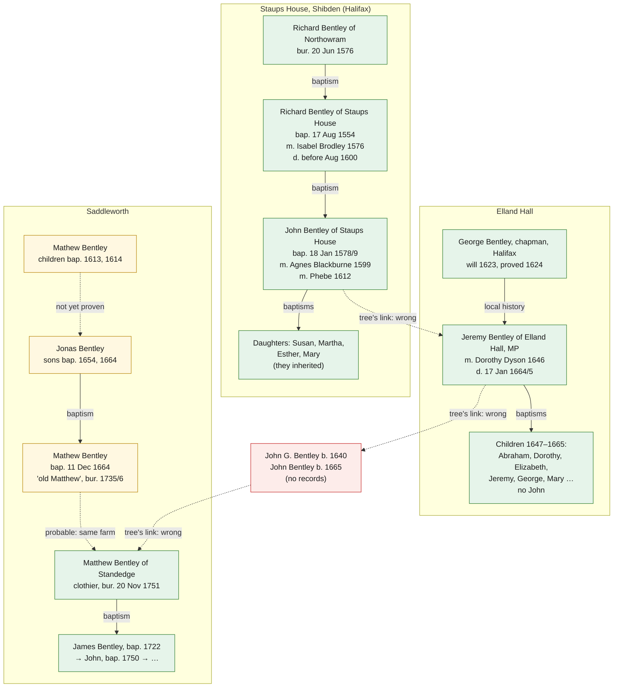

# The two breaks in the tree

10 October 2026 (follow-up to the [tree check](2026-10-10-tree-check.md))

The tree check found two places where the Ancestry tree breaks:

1. **Edward → Richard (1554):** was the Richard who married Isabel Brodley the son of Edward
   Bentley of Ovenden, as the tree says, or of Richard Bentley of Northowram?
2. **The 1600s:** how does Jeremiah Bentley (died 1665) connect to John Bentley above him and to
   the Saddleworth Bentleys below him?

This file settles both as far as online records allow, using the Halifax, Elland, Bingley,
Birstall and Saddleworth registers on FreeREG; the printed Halifax registers (to 1593); the
published indexes of York wills; and the Calderdale Companion. Sources are listed at the end.

## The answers

**Break 1.** The Richard who married Isabel Brodley was almost certainly the son of **Richard
Bentley of Northowram**, not Edward of Ovenden. He lived at **Staups House, Shibden**, and died
before 1600. His son John Bentley of Staups House left his land to his **daughters**.

**Break 2.** Jeremiah is **Jeremy Bentley of Elland Hall**, son of **George Bentley, a Halifax
chapman**. He has nothing to do with John and Phoebe. His children are all in the Elland register
from 1647 on, and none is a John. The "John born 1640" and "John born 1665" who carry the tree on
to Saddleworth have no records. The John Bentley who married Grace Horsfeild was married at
Bingley in 1684.

**What this means.** The Ancestry tree joins two separate families:

- **The Staups House Bentleys of Shibden, Halifax.** Their male line ends with John Bentley of
  Staups House (died 1620s–1640s), whose daughters inherited.
- **The Saddleworth Bentleys.** The records trace them back without a break to Matthew Bentley
  of Standedge (died 1751), and very probably to Jonas Bentley in the 1650s and a Mathew Bentley
  in 1613, when the Saddleworth registers begin.

So **the correct line to take further back is the Saddleworth one.** No record yet connects it to
Halifax or High Bentley.

Green: found in records that name the parent. Yellow: found in records, but a link still needs
proof. Red: no record. Arrows labelled "tree's link: wrong" are links in the Ancestry tree that
the records contradict.

## Break 1: which Richard?

### The Richard Bentleys of Halifax parish, 1550–1621

The registers show several Richard Bentleys at the same time. Three matter here.

**Richard Bentley of Northowram (the elder)**

- His son Richard was baptised on 17 August 1554: "Richard fili[us] Richardi Bentley de
  North[owra]m eodem die" (PRH I, p. 84). This is the exact date the tree gives for its Richard.
- "Rychard Bentlaye de Northourū and his wyffe wear buryed", 20 June 1576 (PRH II, p. 273).
- No will is indexed for him at York, so he probably died intestate.

**Richard Bentley of Shibden and Staups House (the younger)**

- **Married Isabel Brodley** on 22 October 1576, four months after his father's burial: "Rychard
  Bentlaye et Isabell Brodlye" (PRH II, p. 83).
- **An infant** of "Ric. Bentley de Northour." was buried on 26 October 1577 (PRH II, p. 278).
- **His son John** was baptised on 18 January 1578/9: "Johne fil. Ric. Bentleye de Shepdē" (PRH I,
  p. 252).
- **The Calderdale Companion** describes him as "Of Staups House, Shibden. He married Isabel.
  Child: John" (Ref 68-87). Of Isabel it says: "After Richard's death, she married Edward Sawley"
  (Ref 68-93).
- **Isabel's remarriage:** "Edw: Sawley" of Northowram married "Isabel Bentleye" at Halifax on
  18 August 1600
  ([FreeREG](https://www.freereg.org.uk/search_records/68656bedb18f7c3514f67af4/edw-sawley-isabel-bentleye-marriage-yorkshire-west-riding-halifax-1600-08-18)).
  So **Richard was dead by August 1600.** No burial for him appears in the printed registers to
  1593, so he probably died between 1593 and 1600. The Halifax burials for those years aren't
  transcribed online.

**Richard Bentley of Ovenden, son of Edward**

- Baptised 28 May 1559, "Richardus fili[us] Edwardi Bentley de Ovēden" (PRH I, p. 120).
- A Richard Bentley **of Ovenden** had children baptised at Halifax in 1580, 1582, 1585/6 and 1589
  (PRH I, OCR text), and again in 1595 and July 1599
  ([1595](https://www.freereg.org.uk/search_records/5f15b948f493fd147f09f019/frace-bentley-baptism-yorkshire-west-riding-halifax-1595-09-28),
  [1599](https://www.freereg.org.uk/search_records/5f15b95bf493fd147f09f27f/edw-bentley-baptism-yorkshire-west-riding-halifax-1599-07-01)).

### Why the tree's Richard is the Northowram one

- **The date.** The tree's birth date for Richard, 17 August 1554 at Northowram, belongs to the
  son of Richard Bentley of Northowram.
- **The timing.** The elder Richard of Northowram was buried in June 1576. His son married four
  months later, as a young man coming into his inheritance often did.
- **The place.** Isabel's husband and their son John lived at Shibden, in Northowram township.
  Edward's son Richard stayed at Ovenden, a few miles away, raising his own family there through
  the 1580s and 1590s.
- **The deaths.** Isabel's husband was dead by August 1600. The Ovenden Richard was still having
  children baptised in July 1599 (the same man, or his son of the same name).

This isn't absolute proof: no single document says "Richard son of Richard married Isabel". That
would most likely come from the Wakefield manor court rolls, which record heirs taking up
copyhold land. Shibden and Northowram were in the manor of Wakefield. But every record points the
same way, and none supports Edward.

**Corrections to the tree:**

- Richard did not die on 10 June 1636 at Cleckheaton. He was dead by 1600, and no Richard
  Bentley burial for 1636 appears in the Birstall (Cleckheaton) register.
- Isabel did not die in 1589 at Barrow-upon-Humber. She remarried at Halifax in 1600.
- The burial of "Vx[or] Ric. Bentley de Northourū" on 18 April 1584, mentioned in the tree check
  as possibly Isabel, must be the wife of a different Richard.
- The will of "Richard Bentley, Northowram, clothier", dated 7 July 1640 (YAS RS 4), belongs to a
  later Richard.

### John Bentley of Staups House and his daughters

- **Baptised** 18 January 1578/9, son of Richard Bentley of Shibden (above).
- **Probably married Agnes Blackburne** at Halifax on 24 September 1599
  ([FreeREG](https://www.freereg.org.uk/search_records/68656be2b18f7c3514f67803/john-bentley-agnes-blackburne-marriage-yorkshire-west-riding-halifax-1599-09-24)).
  This is the couple the tree calls "Jon Bentley the Elder" and Agnes Blackburne. Several John
  Bentleys married at Halifax around then, but the children below fit.
- **Daughters baptised at Halifax,** father "John Bentley of Northowram":
  [Susan, 26 Jan 1605](https://www.freereg.org.uk/search_records/5f15be82f493fd147f0a53eb/susan-bentley-baptism-yorkshire-west-riding-halifax-1605-01-26),
  [Martha, 24 Apr 1608](https://www.freereg.org.uk/search_records/5f15be10f493fd147f0a4005/martha-bentley-baptism-yorkshire-west-riding-halifax-1608-04-24)
  and
  [Esther, 10 Mar 1610](https://www.freereg.org.uk/search_records/5f161025f493fd147f0e7a3a/ester-bentley-baptism-yorkshire-west-riding-halifax-1610-03-10).
  The transcript gives these dates without dual years.
- **The Calderdale Companion** (Ref 68-116): "Yeoman. Son of Richard Bentley. Owned Staups House,
  Shibden. In 1612, he married Phebe. Children: Martha who married Robert Bairstow, Esther who
  married Joshua Crowther, Marie who married Thomas Stone, Susannah who married Jeremy Holgate.
  The girls inherited their father's land and property." Since Susan, Martha and Esther were born
  before 1612, they were Agnes's children and Phebe was John's second wife.
- **Staups House:** "House mentioned as the home of John Bentley in 1607. It is dated IC 1684 for
  his grandson, John Crowther" (Calderdale Companion, Ref S193). So the house passed down through
  the daughters.
- **Phoebe Longbotham:** the only Phebe Longbotham baptism found is on 29 October 1609, daughter
  of Samuel Longbotham of Warley
  ([FreeREG](https://www.freereg.org.uk/search_records/5f15be3cf493fd147f0a4917/phebe-longbotham-baptism-yorkshire-west-riding-halifax-1609-10-29)).
  That's probably the source of the tree's "born 1608", but a girl born in 1609 can't be the
  Phebe who married John in 1612. Phebe's maiden name is unknown.
- **The tree's second John** (born about 1603, married Phoebe) has no baptism. The Halifax
  transcript has a gap from 1601 to 1605, so that alone proves little. But he seems to be the same
  man as John the Elder, split in two.
- **When did John die?** A "John Bentley, Northowram, yeoman" made his will on 18 August 1626,
  proved 13 July 1627 (York Reg. 39, f. 214; YAS RS 32). The Calderdale Companion gives
  "[15??–164?]" and the tree gives 21 January 1648. Reading the 1626 will would settle whether it
  is his.

## Break 2: Jeremiah Bentley and the two Johns

### Jeremy Bentley of Elland Hall

- **His father.** The Calderdale Companion gives his father as George Bentley "of the Old Hall –
  or Moot Hall, Halifax. He was a chapman. … Child: Jeremy" (Ref 68-96; [foldout
  ZZ_23](https://calderdalecompanion.co.uk/zz_23.html)). The York index lists the will of
  **"Bentley, George, Hallifax, chapman"**, dated 19 July 1623 and proved 18 September 1624 (York
  Reg. 38, f. 230; YAS RS 32). That will should name George's children.
- **George's family.** A George Bentley married Mary Waterhouse at Halifax on 17 January 1596/7
  ([FreeREG](https://www.freereg.org.uk/search_records/68656bc6b18f7c3514f671bf/george-bentley-mary-wat-er_-house-marriage-yorkshire-west-riding-halifax-1597-01-17)).
  A George Bentley of Halifax had children baptised in 1610
  ([Grace](https://www.freereg.org.uk/search_records/5f15bda5f493fd147f0a2b6c/grace-bentley-baptism-yorkshire-west-riding-halifax-1610-02-17)),
  1617
  ([Timothy](https://www.freereg.org.uk/search_records/5f15b61ff493fd147f09bf23/timothy-bentley-baptism-yorkshire-west-riding-halifax-1617-04-13)),
  1619 (Elizabeth) and 1621 (Anna). A Timothy Bentley was among the 59 voters when Jeremy was
  elected in 1654. No baptism for Jeremy has been found: the Halifax transcript has no Bentley
  baptisms from 1622 to 1645. The tree's "1624, Almondbury" is unconfirmed. Almondbury is where he married.
- **His marriage.** He married Dorothy, daughter of Abraham Dyson, at Almondbury on 20 May 1646
  (Calderdale Companion).
- **His children,** all baptised at Elland (FreeREG, Elland parish register):

  | Child | Event | Record |
  | --- | --- | --- |
  | Abraham | bap. 12 Sep 1647 | [FreeREG](https://www.freereg.org.uk/search_records/685d7917865574817e2edfd9/abrahamus-bentley-baptism-yorkshire-west-riding-elland-1647-09-12) |
  | Jeremiah | bap. 9 Jan 1651/2; bur. 14 Apr 1652 | [FreeREG](https://www.freereg.org.uk/search_records/685d7935865574817e2ee76e/jerimiah-bentley-baptism-yorkshire-west-riding-elland-1652-01-09) |
  | Jeremiah | bap. 9 Jun 1653; "Jeremy son of Jeremy" bur. 23 Aug 1654 | FreeREG |
  | Hannah | bur. 21 Aug 1655, "Mr Jeremy Bentley" | FreeREG |
  | Dorothy | born 2 Dec, bap. 19 Dec 1655, "Mr Jeremy Bentley" | [FreeREG](https://www.freereg.org.uk/search_records/685d794a865574817e2eebfc/dorothie-bentley-baptism-yorkshire-west-riding-elland-1655-12-19) |
  | Jane | bap. 18 Feb 1656/7, "Jeremy Bentley of Eland gent"; bur. 25 Feb 1656/7 | [FreeREG](https://www.freereg.org.uk/search_records/685d7951865574817e2eed56/jane-bentley-baptism-yorkshire-west-riding-elland-1657-02-18) |
  | Elizabeth | bap. 29 Jun 1658, "Mr Jeremy Bentley" | [FreeREG](https://www.freereg.org.uk/search_records/685d7957865574817e2eeed4/elizabeth-bentley-baptism-yorkshire-west-riding-elland-1658-06-29) |
  | Jeremy | bap. 9 May 1661 | [FreeREG](https://www.freereg.org.uk/search_records/685d7967865574817e2ef26f/jeremie-bentley-baptism-yorkshire-west-riding-elland-1661-05-09) |
  | George | bap. 1662, "generosus"; bur. 15 Sep 1663 | FreeREG |
  | Mary | bap. 11 Mar 1664/5, after her father's death | [FreeREG](https://www.freereg.org.uk/search_records/685d797d865574817e2ef956/maria-bentley-baptism-yorkshire-west-riding-elland-1665-03-11) |

  This matches the Calderdale Companion ("Abraham, Jeremy, Mary [b 1664] who was born
  posthumously"). There is no John, and no child before the 1646 marriage. Naming a son George
  fits a father called George.
- **His death:** 17 January 1664/5, from Oliver Heywood's diary. His burial at Elland hasn't been
  found in the transcript.

### The tree's John (born 1640) and John (born 1665)

- **No baptism for either.** FreeREG's West Riding transcripts list fifteen John Bentley baptisms
  between 1636 and 1670: at Elland, Bolton-by-Bowland, Methley, Bradford, Calverley, Halifax,
  Bingley, Saddleworth, Leeds and Fewston. None is in 1640 or on 28 April 1665.
- **John Bentley married Grace Horsfeild at Bingley** on 8 February 1684 (as transcribed)
  ([FreeREG](https://www.freereg.org.uk/search_records/685cd17a865574817ef9b99c/john-bentley-grace-horsfeild-marriage-yorkshire-west-riding-bingley-1684-02-08)).
  So the tree's John (born 1665, married Grace, died at Baildon about 1737) was a Bingley and
  Baildon man. Attaching him to Saddleworth, and making him Matthew's father, has no support.

## The Saddleworth line, going back

Bentley entries in the Saddleworth (St Chad) transcript before 1720, with the father's name where
given:

| Date | Event | Record |
| --- | --- | --- |
| 1 May 1613 | An, daughter of **Mathew** Bentley, baptised | [FreeREG](https://www.freereg.org.uk/search_records/685e4b38865574817e6e3407/an-bentley-baptism-yorkshire-west-riding-saddleworth-1613-05-01) |
| 2 Dec 1614 | Mathew, son of **Mathew**, baptised | [FreeREG](https://www.freereg.org.uk/search_records/685e4b3e865574817e6e34c2/mathew-bentley-baptism-yorkshire-west-riding-saddleworth-1614-12-02) |
| 27 Aug 1654 | John, son of **Jonas**, baptised (born 16 Aug) | [FreeREG](https://www.freereg.org.uk/search_records/685e4b5d865574817e6e3db7/john-bentley-baptism-yorkshire-west-riding-saddleworth-1654-08-27) |
| 8 Feb 1657/8 | "Mathey" Bentley buried | [FreeREG](https://www.freereg.org.uk/search_records/685e4dd2865574817e6f96b4/mathey-bentley-burial-yorkshire-west-riding-saddleworth-1658-02-08) |
| 11 Dec 1664 | **Mathew, son of Jonas**, baptised | [FreeREG](https://www.freereg.org.uk/search_records/685e4b69865574817e6e41a7/mathew-bentley-baptism-yorkshire-west-riding-saddleworth-1664-12-11) |
| 6 Jul 1686 | Jonah Bentley buried | [FreeREG](https://www.freereg.org.uk/search_records/685e4de7865574817e6f9c14/jonah-bentley-burial-yorkshire-west-riding-saddleworth-1686-07-06) |
| 15 Sep 1700 | Ester, daughter of **Mathew**, baptised | [FreeREG](https://www.freereg.org.uk/search_records/685e4bba865574817e6e6c2f/ester-bentley-baptism-yorkshire-west-riding-saddleworth-1700-09-15) |
| Dec 1702 | A daughter of Mathew buried | FreeREG |
| 14 Feb 1702/3 | John, son of **Mathew**, baptised | [FreeREG](https://www.freereg.org.uk/search_records/685e4bc0865574817e6e6deb/john-bentley-baptism-yorkshire-west-riding-saddleworth-1703-02-14) |
| 5 May 1719 | Ellin, **wife of Mathew**, buried | [FreeREG](https://www.freereg.org.uk/search_records/685e4e02865574817e6fa41c/elline-bentley-burial-yorkshire-west-riding-saddleworth-1719-05-05) |
| 26 Feb 1735/6 | Matthew Bentley of Stone-edge, "shown as 'old Matthew'", buried | [FreeREG](https://www.freereg.org.uk/search_records/685e4e66865574817e6fc59a/matthew-bentley-burial-yorkshire-west-riding-saddleworth-1736-02-26) |
| 20 Nov 1751 | Matthew Bentley of Stone-edge, clothier, buried | [FreeREG](https://www.freereg.org.uk/search_records/685e4e99865574817e6fd8fa/matthew-bentley-burial-yorkshire-west-riding-saddleworth-1751-11-20) |

How these fit together:

- **Mathew, son of Jonas (baptised 1664)** is the only Mathew baptism in the right period. He
  would have been 71 in 1736, which fits "old Matthew". A Mathew was having children in
  1700–1703, and his wife Ellin died in 1719.
- **Matthew of Standedge** (died 1751, recorded as born about 1692) lived and was buried at the same
  farm, Stone-edge (Standedge). An "old Matthew" there implies a younger Matthew at the same
  place. That makes old Matthew very probably his father. Matthew's own baptism hasn't been
  found: the transcript has only two Bentley baptisms between 1690 and 1700, so there is probably
  a gap.
- **Jonas Bentley** had sons in 1654 and 1664. "Jonah Bentley" buried in 1686 is probably him.
- **The earliest Saddleworth Bentley found is a Mathew** with children baptised in 1613 and 1614.
  He may be the "Mathey" buried in 1657/8. How he relates to Jonas is not yet known. The
  Saddleworth registers start in 1613 (bishop's transcripts from 1612).
- **A lead:** Bentley Farmhouse, Whimberry Lee Lane, Bleak Hey Nook, Saddleworth, is a mid-18th-
  century Grade II listed farmhouse (list entry 1068123) near Standedge. It was probably named
  after this family.

**Probable line:** Mathew (fl. 1613) → ? → Jonas (fl. 1654–1664) → Mathew (bap. 1664, "old
Matthew", d. 1736) → Matthew of Standedge (d. 1751) → James (bap. 1722) → John (bap. 1750) → …

## A lead on High Bentley Hall

These records suggest how High Bentley passed out of the Bentley name:

- **30 June 1540:** "Agnes, the late wife of John Bentley" held land at High Bentley
  ([source checks](2026-10-10-source-checks.md)).
- **20 November 1542:** Agnes Bentley, widow, married **Edward Berstowe** (Bairstow) (PRH II,
  p. 11).
- **17 January 1562/3:** "Joh̃es Berstowe de Hie Bentlei" buried (PRH II, p. 221).
- **12 January 1576:** will of Thomas Bairstowe of High Bentley in Shelf (YAS RS 19).
- **November 1577:** John, son of John Bayrstall of High Bentley, buried (PRH II, p. 278).
- **1661 onwards:** the Wade family. The house was cased in stone in 1661 for Richard Wade, and a
  will of Richard Waide of High Bentley is dated 2 May 1666 (YAS RS 60).

If Agnes's interest in High Bentley passed to the Bairstows through her second marriage, that
would explain why no Bentleys are found at High Bentley after the 1540s. It also points the
search for the High Bentley Bentleys' own heirs to John Bentley of Shelf's children, who aren't
yet identified.

## Sources

- **PRH I:** *The Parish Registers of Halifax*, Vol. I (baptisms 1538–1593), ed. E. W. Crossley,
  Yorkshire Parish Register Society vol. 37 (1910).
  [Scan](https://archive.org/details/parishregisterof37hali)
- **PRH II:** the same, Vol. II (marriages and burials 1538–1593), YPRS vol. 45 (1914).
  [Scan](https://archive.org/details/parishregisterof45hali)
- **FreeREG:** [freereg.org.uk](https://www.freereg.org.uk/). The Halifax entries from 1593 are
  partly from the parish register and partly from an older transcript, with gaps. Elland is from
  the parish register. Saddleworth is from an older transcript by John Lacey, with gaps.
- **YAS RS:** Yorkshire Archaeological Society Record Series, indexes of wills in the York
  Registry: vol. 19 (1568–1585), vol. 32 (1620–1627), vol. 4 (1636–1652), vol. 60 (1666–1672).
  Scans on the Internet Archive: [vol. 19](https://archive.org/details/YASRS019),
  [vol. 32](https://archive.org/details/YASRS032), [vol. 4](https://archive.org/details/YASRS004),
  [vol. 60](https://archive.org/details/YASRS060).
- **Calderdale Companion:** [Bentley surname page](https://calderdalecompanion.co.uk/mmb122.html)
  (Refs 68-87, 68-93, 68-96, 68-116), [S pages](https://calderdalecompanion.co.uk/s.html) (Staups
  House S193; Edward Sawley S641), [Jeremy Bentley](https://calderdalecompanion.co.uk/zz_23.html).
- **Historic England** list entry 1068123 (Bentley Farmhouse, Saddleworth), read via
  [British Listed Buildings](https://britishlistedbuildings.co.uk/101068123-bentley-farmhouse-saddleworth).

All PRH entries cited here were checked against the page scans, except where marked as OCR text.
